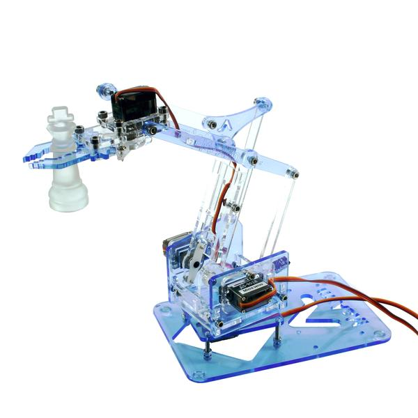

# Use a [PCA9685](https://learn.adafruit.com/16-channel-pwm-servo-driver) to drive a [MeArm](https://shop.mearm.com/)

### All in Python

The MeArm is a robotic arm, using 4 micro servos.
- One to move the arm up and down (located at the LEFT of the arm)
- One to move the arm back and forth (located at the RIGHT of the arm)
- One to move the arm left and right (located at the BOTTOM of the arm)
- One to open and close the claw (located on the CLAW)

To drive those four servos, we will use the PCA9685 PCB.

---

More soon here.

---